# Task 1: Arsitektur & Pipeline CI/CD

## 1. Diagram Arsitektur

Topologi berjalan di region **AWS `ap-southeast-1` (Singapore)** pada dua _Availability Zones_ (`ap-southeast-1a` dan `ap-southeast-1b`).

```mermaid
flowchart LR
    %% ==========================================
    %% 1. EXTERNAL USER TRAFFIC
    %% ==========================================
    subgraph USER_ZONE ["1. External User Traffic"]
        direction TB
        USERS(("End Users<br/>(Browser / Mobile)"))
    end

    %% ==========================================
    %% 2. DEVSECOPS CI/CD PIPELINE
    %% ==========================================
    subgraph CICD_ZONE ["2. Pipeline CI/CD"]
        direction TB
        GH["GitHub Repos<br/>(Backend & Frontend)"]
        CP["AWS CodePipeline<br/>(AWS CodeConnections)"]
        CB["AWS CodeBuild<br/>(Unit Test, SAST, SCA & Docker Build)"]
        SCAN["Container Scan<br/>(Trivy / ECR Inspector)"]
        ECR["Amazon ECR<br/>(Immutable Git SHA)"]

        GH -->|Push main| CP --> CB --> SCAN -->|Push Image| ECR
    end

    %% ==========================================
    %% 3. AWS VPC PRODUCTION (MULTI-AZ)
    %% ==========================================
    subgraph VPC_ZONE ["3. AWS VPC (ap-southeast-1 Multi-AZ)"]
        direction TB

        subgraph PUB_SUBNET ["Public Subnets (AZ-a & AZ-b)"]
            direction LR
            ALB["Application Load Balancer<br/>(/* -> FE | /api/* -> BE | /otel/* -> OTel)"]
            NAT["NAT Gateway<br/>(Outbound Internet)"]
        end

        subgraph PRIV_APP ["Private App Subnets (AZ-a & AZ-b)"]
            direction TB
            ASG_BE["EC2 ASG: Backend HTTP<br/>(Laravel + OTel PHP Auto-Instr)"]
            ASG_FE["EC2 ASG: Frontend<br/>(Vue Nginx + OTel Web SDK + config.js)"]
            WORKER["Queue Worker & Scheduler<br/>(Image BE sama - CONTAINER_ROLE=worker/cron)"]
            OTEL["OTel Collector Gateway<br/>(OTLP, Tail-Sampling, PII Redaction, DB Receivers)"]
        end

        subgraph PRIV_DATA ["Private Data Subnets (AZ-a & AZ-b)"]
            direction LR
            RDS[("RDS MySQL 8.0<br/>(Multi-AZ + Performance Insights)")]
            REDIS[("ElastiCache Redis<br/>(Session, Cache & Queue)")]
        end

        %% Internal VPC Routing & App Connections
        ALB -->|/*| ASG_FE
        ALB -->|/api/*| ASG_BE
        ALB -->|/otel/* Browser OTLP| OTEL

        ASG_BE & WORKER --> RDS
        ASG_BE & WORKER --> REDIS

        %% Telemetry Ingestion to OTel Collector
        ASG_BE & WORKER -->|Traces, Logs, DB SemConv| OTEL
        RDS & REDIS -.->|MySQL & Redis Receivers| OTEL
        OTEL -->|Egress| NAT
    end

    %% ==========================================
    %% 4. AWS MANAGED SERVICES (STORAGE, SECRETS, FLAGS)
    %% ==========================================
    subgraph AWS_SERVICES ["4. AWS Managed Services"]
        direction TB
        S3[("Amazon S3<br/>(Laravel File Uploads)")]
        SM["AWS Secrets Manager<br/>(DB Creds, APP_KEY, OTLP Token)"]
        SSM["AWS SSM Parameter Store<br/>(Non-Secret Public Config)"]
        APPCONFIG["AWS AppConfig<br/>(Feature Flags & Kill Switch)"]
    end

    %% ==========================================
    %% 5. OBSERVABILITY BACKEND (OTLP COMPATIBLE)
    %% ==========================================
    subgraph OBS_ZONE ["5. Observability Backend (Grafana Cloud / OTLP)"]
        direction TB
        LGTM["Grafana Cloud (LGTM + Pyroscope)<br/>Logs - Metrics - Traces - Profiles"]
        SYNTH["Synthetic Healthcheck<br/>(Uptime Probe)"]
        ALERT["Unified Alerting<br/>(Slack P1/P2, PagerDuty, Email)"]

        LGTM --> ALERT
    end

    %% ==========================================
    %% CROSS-ZONE CONNECTIONS
    %% ==========================================
    USERS -->|HTTPS| ALB
    SYNTH -.->|Ping /api/health| ALB

    ECR -.->|ASG Instance Refresh| ASG_BE & ASG_FE & WORKER
    SM -.->|Build/Test Vars| CB
    SM -.->|Secrets via IAM| ASG_BE & WORKER & OTEL
    SSM -.->|Generate Runtime config.js| ASG_FE

    ASG_BE & WORKER --> S3
    APPCONFIG -.->|Dynamic Flags| ASG_BE & WORKER

    NAT -->|Export OTLP| LGTM
    ALERT -.->|Trigger Kill Switch| APPCONFIG
```

---

## 2. Alur CI/CD Pipeline

1. **Source Code**:
   - Backend (Laravel API) dan Frontend (Vue.js SPA) di repo GitHub terpisah.
   - Terhubung ke AWS CodePipeline via AWS CodeConnections (sebelumnya bernama CodeStar Connections).
2. **Build & Test (AWS CodeBuild)**:
   - **Backend**:
     - Pasang dependency: `composer install --no-dev --prefer-dist --optimize-autoloader`.
     - Test: unit dan integration test via `php artisan test`.
     - Static analysis & SCA: `composer audit`, `phpstan`/Larastan level 5.
     - Docker build: multi-stage build (base image PHP-FPM 8.2 Alpine + Nginx).
     - Security scan: Trivy scan image (stop build jika ada issue severity `CRITICAL`).
   - **Frontend**:
     - Pasang dependency: `npm ci`.
     - Test & lint: `npm run test:unit` dan `npm run lint`.
     - Audit dependency: `npm audit --production`.
     - Compile asset: `npm run build` menghasilkan file statis SPA.
     - Docker build: Nginx unprivileged Alpine untuk serve static files.
3. **Container Registry (Amazon ECR)**:
   - Setiap image diberi tag **Git Commit SHA** (`sha-xxxxxxx`) dengan setting `IMMUTABLE`. Tag `latest` di-push sebagai penanda rilis aktif.
   - Tag immutable mencegah duplikasi image dan memastikan versi bisa di-rollback dengan pasti.
4. **Strategi Migrasi Database**:
   - Eksekusi migrasi database (`php artisan migrate --force`) dijalankan sebelum instance baru menerima trafik:
     - **Metode 1 (ASG Lifecycle Hook / SSM Run Command):** Sebelum instance masuk Target Group ALB, lifecycle hook menjalankan migrasi via SSM Run Command dari satu instance terpilih di VPC.
     - **Metode 2 (CodeBuild VPC Configuration):** Memberikan akses `vpc_config` ke CodeBuild agar dapat terhubung langsung ke RDS MySQL di Private Data Subnet.
   - Migrasi wajib menggunakan pola **Expand and Contract** (perubahan skema non-breaking) agar instance versi lama dan baru dapat jalan bersamaan saat rolling deployment.
5. **Deployment Zero-Downtime**:
   - CodePipeline memicu ASG Instance Refresh pada Launch Template yang mengarah ke tag Git SHA baru.
   - Instance baru boot di Private App Subnet, pull image dari ECR, ambil kredensial dari Secrets Manager, lalu jalankan container.
   - ALB health check memverifikasi endpoint `/api/health`.
   - Setelah instance baru berstatus `healthy`, ALB mengalirkan trafik ke instance baru dan menjalankan connection draining (30 detik) pada instance lama sebelum dimatikan.

---

## 3. Desain Jaringan & Compute

- **Topologi Subnet**:
  - **Public Subnet (`AZ-a` & `AZ-b`):** Berisi ALB dan NAT Gateway. Tidak ada instance aplikasi di layer ini.
  - **Private App Subnet (`AZ-a` & `AZ-b`):** Berisi EC2 ASG Backend, Frontend, Worker, dan OTel Collector Gateway. Tanpa public IP; akses outbound ke internet melalui NAT Gateway.
  - **Private Data Subnet (`AZ-a` & `AZ-b`):** Berisi RDS MySQL Multi-AZ dan ElastiCache Redis. Tidak ada route table ke internet. Security group hanya mengizinkan inbound dari App Tier ke port 3306 dan 6379.
- **Routing ALB (Path-Based)**:
  - `/*` -> Target Group Frontend Vue.js (Port 80).
  - `/api/*` -> Target Group Backend Laravel API (Port 8000).
  - `/otel/*` -> Proxy ke OTel Collector Gateway (Port 4318) untuk Core Web Vitals browser tanpa mengekspos token internal.
  - Berada di bawah satu domain utama untuk menghindari masalah CORS.
- **Image Multi-Role**:
  - Image _backend_ yang dipakai merupakan image yang sama, hanya dibedakan via `CONTAINER_ROLE`:
    - `CONTAINER_ROLE=app`: Menjalankan Nginx + PHP-FPM untuk trafik HTTP API.
    - `CONTAINER_ROLE=worker`: Menjalankan `php artisan queue:work` via Supervisor untuk memproses job Redis.
    - `CONTAINER_ROLE=scheduler`: Menjalankan `php artisan schedule:run`.

---

## 4. Secret and Configuration Management

- **AWS Secrets Manager**:
  - Menyimpan `DB_PASSWORD`, `APP_KEY`, `REDIS_AUTH_TOKEN`, dan token OTLP.
  - Diambil instance saat boot via IAM Instance Profile tanpa hardcode token di file konfigurasi.
- **AWS SSM Parameter Store**:
  - Menyimpan konfigurasi non-sensitif frontend (`API_BASE_URL`, app ID).
  - Saat container Vue.js start, entrypoint script men-generate `/config.js` dari SSM Parameter Store sehingga image Docker dapat langsung mengambil konfigurasi dinamis saat runtime tanpa perlu rebuild.
- **AWS AppConfig**:
  - Mengelola _feature flag_ dan _circuit breaker_ saat runtime tanpa redeploy aplikasi.
  - Backend Laravel mengambil konfigurasi secara berkala (cache di Redis) dan meneruskannya ke frontend melalui endpoint `/api/v1/feature-flags`.
